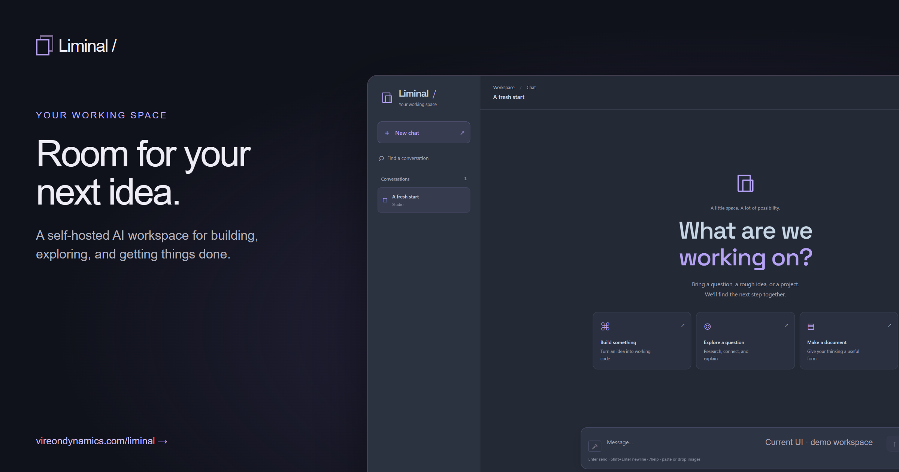
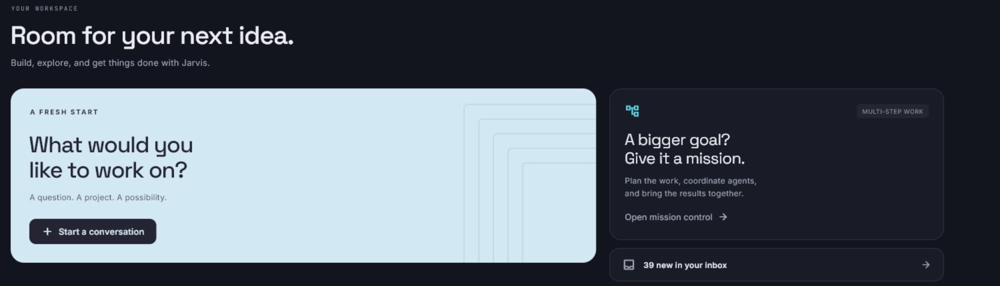
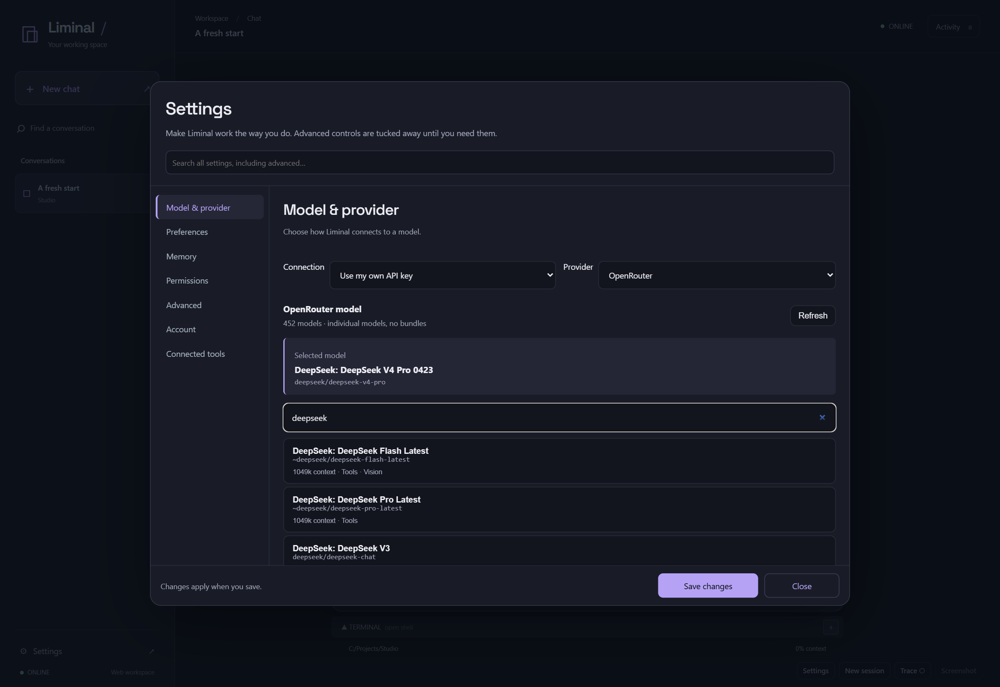
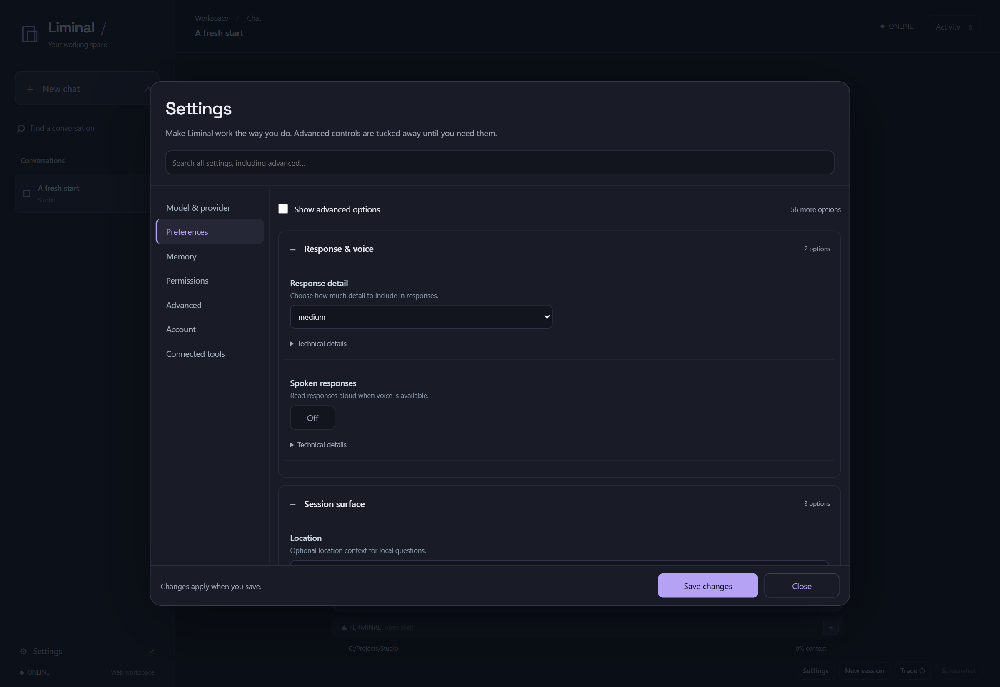

<div align="center">

# Liminal AI

### Your models. Your tools. Your workspace.

A self-hosted AI agent for code, research, documents, and everyday work.<br>
Run it on your machine through a native desktop app, a browser, or your terminal.

[](https://github.com/traidy2222/liminal-ai/actions/workflows/ci.yml)
[](LICENSE)
[](https://github.com/traidy2222/liminal-ai/releases)

**[Download desktop](https://github.com/traidy2222/liminal-ai/releases) · [Get started](#get-started) · [Documentation](https://docs.vireondynamics.com/liminal/) · [Product website](https://www.vireondynamics.com/liminal)**



</div>

Liminal connects a model to the tools it needs to do useful work: read and edit files, run commands, search the web, create documents, and work with connected services. Its agent loop handles tool execution, approvals, retries, context management, and persistent memory.

**Release status:** Liminal is in beta. [Desktop 0.1.21](https://github.com/traidy2222/liminal-ai/releases/tag/v0.1.21-desktop) improves local artifact workflows with bounded binary and ISO tools, accurate MCP discovery, useful recovery after failed programs, and reliable cancellation. Narration and tools stay in chronological order. Includes native local MCP servers and the full REA catalog, Gmail and Google Workspace support, three guided workflows, searchable OpenRouter selection and single-model mode. Screenshots show the application with demo workspace data.

## Why Liminal

- **Choose your model.** Connect OpenRouter, OpenAI, or another OpenAI-compatible endpoint, including a local model server. Capabilities depend on the selected model and provider.
- **Work beyond chat.** A catalog of 245+ tools covers files, shell commands, Git, research, browsers, documents, and integrations. Tool families load on demand.
- **Follow the work.** Inspect streamed responses, tool calls, results, approval requests, and execution traces as the agent works.
- **Keep useful context.** Persistent notes, keyword and optional vector recall, and an optional Obsidian vault help carry knowledge between sessions.
- **Use the interface that fits.** The Flutter desktop app, React web UI, and terminal UI share the same harness engine.

Liminal runs tool execution and stores local workspace state on your machine. Hosted models receive the prompts and context you send them; connected services receive requests when used. Choose a local endpoint when you want inference to run locally too.

## Three workflows with a concrete finish

Start from the desktop or web welcome cards, or type a command in any interface:

| Start | What you receive | Completion check |
|---|---|---|
| **`/proposal <client enquiry>`** | A printable proposal, research sources, and an unsent email draft | Sources must have been fetched successfully |
| **Attach a receipt → `/receipt`** | An expense review with reconciled amounts and the original receipt hash | Local OCR plus date, currency, and arithmetic validation |
| **`/fix <bug report>`** | A patch, captured test output, and a handoff | A reproduced failure, passing tests after edits, and a fresh Git diff |

If requested, the receipt workflow can also create an approved Xero **DRAFT** and attach the source receipt. It checks for duplicates first and resumes an interrupted upload against the existing bill. It does not authorise or pay bills. Xero requires a connected organisation and valid account/tax mappings.

Runs save their progress and deliverables under `.agent_artifacts/workflows/`. Use `/workflows` to find a run and `/resume-work <run-id>` to continue it. These workflows are included in desktop and harness 0.1.5. See the [workflow guide](docs/guides/signature-workflows.md) for examples, prerequisites, and validation scope.

## A workspace built for doing

### Start with the next thing you want to make

The desktop hub brings conversations, connected tools, and multi-step missions into one workspace.



*Captured from the Windows Release build, cropped to the hub's welcome area. “Jarvis” is the configured assistant persona.*

### Choose a model. Keep setup simple.

The model picker replaces OpenRouter model bundles with a searchable catalog of individual models. Search by name or model ID, inspect tool and vision capabilities, and select a model without overwriting your other model choices.

| Searchable OpenRouter models | Focused, everyday settings |
|:---:|:---:|
|  |  |

**Single-model mode** keeps chat, background completions, and vision requests on your selected model. It disables separate embeddings, hosted speech models, and automatic model fallbacks while preserving your previous specialist settings. Vision requires a model that supports image input; keyword memory search remains available.

*Web screenshots use the current application with isolated demo data. They illustrate the interface, not completed agent runs or performance benchmarks. Model availability changes over time. [View the image pack and capture notes](assets/marketing/update-2026-11-02/README.md).*

## Get started

### Desktop

1. Download the archive for your platform from **[GitHub Releases](https://github.com/traidy2222/liminal-ai/releases)**: Windows x64, macOS arm64, or Linux x64.
2. Extract the complete archive and keep its companion files together.
3. Follow the [desktop setup guide](docs/start/install.md#liminal-desktop-portable-zip) to configure your provider and launch the app.

From **0.1.6**, portable installs check for complete releases at launch, download and verify updates, then install and restart before opening your workspace. Choose **Open current version** to skip, or disable automatic updates in **Settings → About & updates**. Offline checks and download failures open the current version.

For the initial upgrade from **0.1.5 or earlier**, download 0.1.6 once and extract it over the closed installation, keeping your local `.env`. This fixes the older packaged-app detection and installer issues. Later launch updates are automatic. Beta builds are published as prereleases.

### Web or terminal

The installer sets up the repository, dependencies, provider configuration, and CLI launcher.

**Windows · PowerShell**

```powershell
irm https://www.vireondynamics.com/install/install.ps1 | iex
```

**macOS · Linux · WSL**

```bash
curl -fsSL https://www.vireondynamics.com/install/install.sh | bash
```

Then choose an interface:

```bash
liminal web --open
liminal tui
```

A Vireon account is optional when using your own provider or a compatible local endpoint. Provider usage charges may apply. For prerequisites, install locations, local models, and troubleshooting, see the [installation guide](docs/start/install.md).

### Run from source

Requires **Node.js 22+**, **npm 10+**, and **Git**. Flutter is needed only when developing the native desktop UI.

```bash
git clone https://github.com/traidy2222/liminal-ai.git
cd liminal-ai
npm install
npm run setup -- --no-launch
node scripts/liminal.mjs web --open
```

The setup wizard writes your provider configuration and builds the required packages. For manual configuration, create a root `.env`:

```dotenv
AGENT_API_KEY=your_provider_key
AGENT_API_BASE_URL=https://openrouter.ai/api/v1
AGENT_MODEL=deepseek/deepseek-v4-pro
```

Then run `npm run build` before launching. Keep API keys in `.env`; use Settings for regular preferences. See [configuration basics](docs/start/configuration-basics.md) for storage locations and precedence.

## What you can build with it

| Workflow | Available capabilities |
|---|---|
| **Code and maintain projects** | File editing, shell commands, Git, code navigation, tests, and optional post-edit verification |
| **Research a question** | Web search, page extraction, browser tools, and source-aware research workflows |
| **Create documents** | PPTX, DOCX, and PDF tooling with layout checks and export support |
| **Work with your services** | Google Workspace, Microsoft 365, and other connectors; authentication and permissions are required |
| **Coordinate larger tasks** | Sub-agents, dynamic workflows, progress tracking, and result verification |
| **Build a knowledge base** | Persistent notes, memory retrieval, and optional Obsidian vault integration |

Tool availability depends on enabled families, local dependencies, credentials, and edition. Approval controls govern protected actions; review the [security documentation](SECURITY.md) before configuring unattended workflows.

## Develop and contribute

Liminal is a TypeScript monorepo with a Flutter desktop frontend. Build dependencies in order: **core → protocol → tools → sidecar**. The root build command handles this sequence.

Installation applies a version-pinned compatibility fix for node-pty 1.1.0 on Windows: terminal cleanup enumerates child processes before console teardown and releases the output worker after natural exit. The same fix ships in desktop and harness archives. Windows CI checks replay, output draining, and exit codes.

```bash
npm run build
npm run typecheck
npm run test
```

| Command | Purpose |
|---|---|
| `npm run web:dev` | Web API on port 3001 and Vite client on port 5173 |
| `npm run tui` | Run the terminal interface |
| `npm run test -w packages/tools` | Run tool tests |
| `npm run test -w packages/sidecar` | Run sidecar tests |
| `npm run eval -w packages/eval -- --only memory` | Run a focused evaluation pack |
| `npm run docs:dev` | Preview the documentation |

```text
apps/liminal_desktop/   Flutter desktop app
packages/core/         Agent loop, context, routing, memory, and approvals
packages/protocol/     Client–sidecar protocol
packages/tools/        Tool implementations and integrations
packages/sidecar/      Desktop runtime and WebSocket server
packages/web/          Express API and React web app
packages/tui/          Terminal interface
packages/eval/         Evaluation scenarios
```

Keep `core` independent of `tools`, add focused checks for changed behavior, and include validation in pull requests. Start with [AGENTS.md](AGENTS.md), [architecture](docs/concepts/architecture.md), and the [desktop development guide](apps/liminal_desktop/README.md).

[Report a bug or request a feature](https://github.com/traidy2222/liminal-ai/issues) · [Security reporting](SECURITY.md)

## Documentation

- [Quickstart](docs/start/quickstart.md) — your first session
- [Configuration](docs/start/configuration-basics.md) — providers, keys, and preferences
- [Environment reference](docs/reference/environment.md) — all managed settings
- [Memory and vault](docs/concepts/memory-and-vault.md) — persistent knowledge
- [Response latency](docs/guides/response-latency.md) — timing definitions and measured observations
- [Troubleshooting](docs/operations/troubleshooting.md) — common setup and runtime issues
- [Changelog](CHANGELOG.md) — project release notes

## License

Liminal is an **open-core, fair-source** project. Community Edition is distributed under [FSL-1.1-MIT](LICENSE). Enterprise features are offered separately; see the [edition and license reference](docs/reference/license.md) and [pricing](https://www.vireondynamics.com/liminal/pricing).

Built by **[Vireon Dynamics](https://www.vireondynamics.com)** in Australia.
